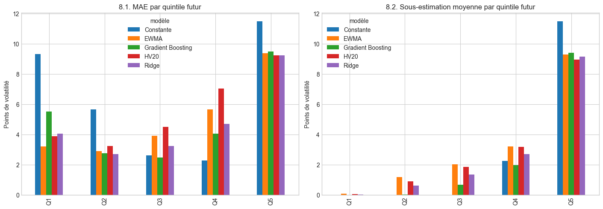

# Financial Risk under Uncertainty

*Forecast Reliability and Sequential Decision-Making*

This repository brings together two distinct empirical studies of financial risk under uncertainty. The first asks when risk forecasts become unreliable. The second asks how sequential financial decisions can be evaluated consistently when information, execution, accounting and settlement constraints matter. They share a commitment to temporal discipline and evidence-limited conclusions, but they are not yet connected by a common empirical architecture.

## 1. Research Overview

| Study | Research question | Main materials |
| :--- | :--- | :--- |
| **Research Study I — Financial Risk Forecast Reliability** | When do financial risk forecasts become unreliable, and can their limitations be identified using information available at the forecast date? | [Executed notebooks `00`–`07`](notebooks/) |
| **Research Study II — Sequential Financial Decision-Making** | How can sequential portfolio allocation policies be evaluated consistently under information, execution, accounting and settlement constraints? | [Scripts, tests and locked results](experiments/sequential-financial-decisions/) |

The two studies have different questions, methods, evidence and levels of maturity. Neither is presented as an extension or application of the other.

## 2. Research Study I — Financial Risk Forecast Reliability

### Research Question

*When do financial risk forecasts become unreliable, and can their limitations be identified using information available at the forecast date?*

### Methodology

The study constructs and audits five-session forward realized volatility (`RV5`) from daily US market returns in the Kenneth R. French Data Library. It uses chronological estimation, validation, refit and exploratory evaluation windows, with boundary purging to prevent target windows from crossing sample splits. Five forecasting specifications are compared: a constant benchmark, `HV20`, `EWMA`, `Ridge` and `Gradient Boosting`.

Evaluation covers average error, underestimation and conditional reliability. The `Q1`–`Q5` regimes are quintiles of *future realized* `RV5`: their thresholds are fixed on 1990–2015, but a date's regime is known only after its outcome. They are therefore ex post diagnostics, not real-time signals. Notebook `07` separately tests two alert rules that use only information available at date `t`.

### Selected Empirical Findings

- Lower average error does not guarantee fewer underestimations when realized risk is high. `HV20` reduces MAE by `31.4%` relative to the constant benchmark, yet underestimates on `84.0%` of dates in `Q5`, a regime identified ex post.
- Model rankings depend on the criterion: `EWMA` has the lowest global MAE, `Ridge` the lowest global RMSE, and `HV20` the lowest `Q5` MAE.
- At least four of the five models strongly underestimate `RV5` on the same `44` dates, grouped into `13` contiguous episodes.
- The two simple ex ante alert rules do not effectively anticipate episode starts: `0/13` for the trailing-volatility level rule and `1/13` for the acceleration rule.

### Limitations

The model comparison is restricted to aggregate US market returns and an exploratory 2016–2019 evaluation window. Future-`RV5` regimes cannot be interpreted as states observable at the forecast date, and the negative result for two simple alert rules does not establish that all ex ante warning systems must fail.

### Figure

*Error by quintile of future realized `RV5`, identified ex post. The figure is reproduced unchanged from [notebook 05, section 8](notebooks/05_benchmark_cinq_modeles.ipynb).*

### Explore Study I

- [Notebooks `00`–`07`](notebooks/) — data audit, target construction, forecast comparisons, conditional diagnostics and ex ante alert rules.
- [Methodological reference](docs/METHODOLOGY.md) — definitions, chronological splits and evaluation criteria.
- [Reproducibility guide](docs/REPRODUCIBILITY.md) — data provenance, verification levels and known limits.

## 3. Research Study II — Sequential Financial Decision-Making

### Research Question

*How can sequential portfolio allocation policies be evaluated consistently under information, execution, accounting and settlement constraints?*

### Methodology

The study evaluates deterministic `SPY`–`BIL` allocation policies within an explicit decision protocol. It separates information admissible at the decision timestamp from later realizations, sizes whole-share orders before observing the historical opening-price proxy, accounts for distributions and `T+1` settlement, and states the simulator's financing assumptions. Yahoo `Open` values are retrospective proxies for hypothetical execution, not demonstrated broker fills.

The completed 2024–2025 episode compares 50/50 buy-and-hold (`C1`), weekly 50/50 rebalancing (`C2`) and a post hoc passive distribution-reinvestment diagnostic (`C3`) across eight cost and cash-availability scenarios. A documentary gate prevents performance calculation when the required market observation cannot be reconciled.

### Selected Empirical Findings

- In the 2024–2025 episode, `C2` finishes `519.07`–`590.12 USD` above `C1` on `100,000 USD` of initial capital across the eight scenarios.
- The scenarios combine four stylised transaction-cost levels with two hypothetical delays in distribution-cash availability.
- `C3 − C1` accounts arithmetically for `13.67%`–`15.02%` of the observed `C2 − C1` difference. The remaining `C2 − C3` gap compares two complete trading policies and is not a pure causal attribution to rebalancing.
- The 2025–2026 episode remains halted by a documentary conflict over the `SPY` opening price on 2026-04-20. No 2025–2026 performance has been calculated.

### Limitations

The completed comparison is a conditional retrospective evaluation of one one-year episode, not evidence of a generally profitable strategy. The second episode was selected after the first was observed; although its protocol was locked before performance calculation, it is not an independent confirmatory test. The evaluated policies are deterministic. No trained reinforcement-learning agent produced these results; reinforcement learning remains only a possible future research direction.

### Figure

*Wealth trajectories for the specific exploratory `S0-D1` scenario. This single scenario does not support generalisation beyond the stated episode and assumptions.*

### Explore Study II

- [Study II overview](experiments/sequential-financial-decisions/README.md) — protocol, policies, results and documentary stopping rule.
- [Scripts](experiments/sequential-financial-decisions/scripts/) and [tests](experiments/sequential-financial-decisions/tests/) — simulator, audits and verification logic.
- [Locked results](experiments/sequential-financial-decisions/results/) — versioned CSV, JSON and SVG artifacts.

## 4. How the Studies Relate

Study I examines the reliability of predictive information about financial risk. Study II examines whether financial decisions are evaluated consistently when the information set, cash flows and operational constraints are made explicit. Both studies rely on temporal discipline, protection against future-information leakage, data verification, condition-specific evaluation and explicit empirical limits.

This is an intellectual connection, not an integrated empirical contribution. The `RV5` forecasts from Study I are not used by the `SPY`–`BIL` policies in Study II. Whether forecast quality and predictive uncertainty can be linked responsibly to sequential allocation decisions remains an open research question.

## 5. Reproducibility and Research Materials

- **Visible:** the eight executed notebooks and the locked outputs of Study II can be inspected directly on GitHub.
- **Auditable without raw data:** tracked fixtures and artifacts support `164` passing tests, with `33` raw-data reconstruction tests skipped.
- **Reproducible with the local archive:** with the manifest-listed files under `data/raw/` and `data/processed/`, all `197` tests and the byte-for-byte result checks pass.
- **Documented limits:** full clean-clone notebook re-execution has not been verified, and third-party data remain excluded pending redistribution review.

Detailed resources: [methodology](docs/METHODOLOGY.md), [reproducibility and provenance](docs/REPRODUCIBILITY.md), [Study I notebooks](notebooks/), and [Study II materials](experiments/sequential-financial-decisions/).

## 6. Research Status and Open Questions

- Study I provides exploratory evidence on forecast reliability and simple ex ante alerts; it does not provide a validated real-time regime-recognition system.
- Study II provides a tested accounting and evaluation framework plus one completed historical episode; its temporal replication attempt remains documentarily blocked.
- The studies are empirically separate. Connecting calibrated forecast uncertainty to sequential decisions is a future research question, not a result of this repository.
- No license has yet been attached, and full independent academic review remains outstanding.

## Research Archive

This branch is the curated academic presentation. The complete development history, intermediate reports and full test history remain preserved on [`main`](https://github.com/MOSSAWIII/ai-financial-risk-reliability/tree/main).
