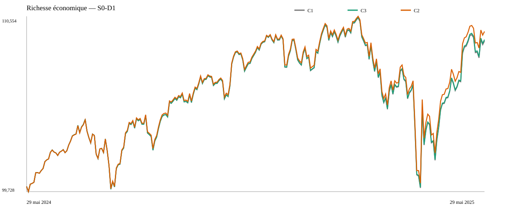

# Diagnostic économique du réinvestissement C1–C2–C3 — 2024–2025

Date d'exécution : 21 octobre 2026

Comparaison C1–C2 verrouillée : commit `49a01a384a68d134e3831cb0dcabc782c060a087`

Nature : analyse complémentaire post hoc, non préenregistrée

Verdict : **`REINVESTMENT_DIAGNOSTIC_VALIDATED`**

## 1. Résultat principal

Le simple réinvestissement passif des distributions explique une partie positive mais minoritaire de l'avantage observé de C2 sur C1. Selon la cellule, C3 ajoute **76,30 à 84,01 USD** à C1 et couvre arithmétiquement **13,67 % à 15,02 %** de l'écart C2−C1. C2 conserve **442,77 à 506,11 USD** d'avance sur C3.

Cette décomposition est une identité entre trois politiques, pas une attribution causale. C3−C1 mesure le contraste associé à la règle précise de réinvestissement définie ici. C2−C3 reste une différence résiduelle qui mêle trajectoires d'exposition, distributions, cash, frais et quantités entières; elle n'est pas une « prime pure de rééquilibrage ».

## 2. Définition et isolation de C3

C3 partage l'achat initial de C1 et C2 : 94 SPY et 544 BIL. Il ne vend jamais, ne vise aucun poids et ne rééquilibre pas SPY contre BIL. Chaque distribution payée alimente, après D+1 ou D+2, une réserve propre à son ETF. À 08:00 ET lors de la première séance NYSE admissible, la quantité entière est figée avec le dernier close disponible et les frais du scénario. L'open n'est lu qu'ensuite; l'ordre est exécuté intégralement ou rejeté, sans redimensionnement.

Le cash résiduel initial est suivi séparément. Les réserves `SPY_distribution_pool` et `BIL_distribution_pool` ne reçoivent que les distributions de leur instrument. Aucun transfert entre réserves, emprunt, découvert, short, vente ou fraction de part n'est admis. Si deux événements devenaient admissibles le même jour, l'ordre déterministe serait SPY puis BIL, puis identifiant d'événement; leurs financements resteraient séparés.

## 3. Comparaison financière des huit cellules

Les rendements, volatilités et drawdowns sont exprimés en pourcentage. Les transactions excluent les deux achats initiaux communs.

| Cellule | Politique | Richesse terminale USD | Rendement | Volatilité ann. | Drawdown max. | Cash terminal USD | Distributions USD | Frais USD | Transactions |
|---|---|---:|---:|---:|---:|---:|---:|---:|---:|
| S0-D1 | C1 | 109 025,96 | 9,0260 % | 10,0222 % | −9,5138 % | 3 671,02 | 3 007,82 | 0,00 | 0 |
| S0-D1 | C3 | 109 109,97 | 9,1100 % | 10,0251 % | −9,5013 % | 780,52 | 3 056,56 | 0,00 | 13 |
| S0-D1 | C2 | 109 616,08 | 9,6161 % | 10,0882 % | −9,3165 % | 449,11 | 3 123,88 | 0,00 | 47 |
| S1-D1 | C1 | 109 016,03 | 9,0160 % | 10,0231 % | −9,5147 % | 3 661,09 | 3 007,82 | 9,93 | 0 |
| S1-D1 | C3 | 109 099,74 | 9,0997 % | 10,0261 % | −9,5022 % | 770,30 | 3 056,56 | 10,23 | 13 |
| S1-D1 | C2 | 109 601,16 | 9,6012 % | 10,0894 % | −9,3184 % | 434,19 | 3 123,88 | 14,72 | 48 |
| S2-D1 | C1 | 108 976,29 | 8,9763 % | 10,0269 % | −9,5181 % | 3 621,35 | 3 007,82 | 49,67 | 0 |
| S2-D1 | C3 | 109 058,83 | 9,0588 % | 10,0300 % | −9,5058 % | 729,38 | 3 056,56 | 51,14 | 13 |
| S2-D1 | C2 | 109 541,69 | 9,5417 % | 10,0925 % | −9,3262 % | 466,44 | 3 123,51 | 73,83 | 49 |
| S3-D1 | C1 | 108 926,62 | 8,9266 % | 10,0317 % | −9,5224 % | 3 571,68 | 3 007,82 | 99,34 | 0 |
| S3-D1 | C3 | 109 007,70 | 9,0077 % | 10,0348 % | −9,5104 % | 678,25 | 3 056,56 | 102,28 | 13 |
| S3-D1 | C2 | 109 466,29 | 9,4663 % | 10,0988 % | −9,3363 % | 391,04 | 3 121,41 | 147,67 | 51 |
| S0-D2 | C1 | 109 025,96 | 9,0260 % | 10,0222 % | −9,5138 % | 3 671,02 | 3 007,82 | 0,00 | 0 |
| S0-D2 | C3 | 109 105,20 | 9,1052 % | 10,0248 % | −9,5014 % | 775,75 | 3 056,56 | 0,00 | 13 |
| S0-D2 | C2 | 109 605,49 | 9,6055 % | 10,0884 % | −9,3174 % | 438,52 | 3 123,88 | 0,00 | 48 |
| S1-D2 | C1 | 109 016,03 | 9,0160 % | 10,0231 % | −9,5147 % | 3 661,09 | 3 007,82 | 9,93 | 0 |
| S1-D2 | C3 | 109 094,97 | 9,0950 % | 10,0257 % | −9,5023 % | 765,52 | 3 056,56 | 10,23 | 13 |
| S1-D2 | C2 | 109 592,21 | 9,5922 % | 10,0891 % | −9,3192 % | 425,24 | 3 123,88 | 14,88 | 48 |
| S2-D2 | C1 | 108 976,29 | 8,9763 % | 10,0269 % | −9,5181 % | 3 621,35 | 3 007,82 | 49,67 | 0 |
| S2-D2 | C3 | 109 054,06 | 9,0541 % | 10,0296 % | −9,5059 % | 724,61 | 3 056,56 | 51,14 | 13 |
| S2-D2 | C2 | 109 530,60 | 9,5306 % | 10,0927 % | −9,3273 % | 455,34 | 3 123,19 | 74,29 | 49 |
| S3-D2 | C1 | 108 926,62 | 8,9266 % | 10,0317 % | −9,5224 % | 3 571,68 | 3 007,82 | 99,34 | 0 |
| S3-D2 | C3 | 109 002,92 | 9,0029 % | 10,0345 % | −9,5104 % | 673,47 | 3 056,56 | 102,28 | 13 |
| S3-D2 | C2 | 109 445,69 | 9,4457 % | 10,0992 % | −9,3382 % | 370,43 | 3 121,41 | 149,39 | 51 |

C2 affiche le meilleur rendement et le drawdown le moins profond dans les huit cellules. C1 conserve la volatilité la plus faible. C3 se situe entre les deux pour ces trois mesures : son risque reste très proche de C1, ce qui est cohérent avec l'absence de ventes et de ciblage d'allocation.

## 4. Identité arithmétique et part couverte

| Cellule | C3−C1 USD | C2−C3 USD | C2−C1 USD | Part arithmétique couverte |
|---|---:|---:|---:|---:|
| S0-D1 | +84,01 | +506,11 | +590,12 | 14,24 % |
| S1-D1 | +83,72 | +501,42 | +585,13 | 14,31 % |
| S2-D1 | +82,54 | +482,86 | +565,40 | 14,60 % |
| S3-D1 | +81,07 | +458,60 | +539,67 | 15,02 % |
| S0-D2 | +79,24 | +500,29 | +579,53 | 13,67 % |
| S1-D2 | +78,95 | +497,24 | +576,19 | 13,70 % |
| S2-D2 | +77,77 | +476,54 | +554,31 | 14,03 % |
| S3-D2 | +76,30 | +442,77 | +519,07 | 14,70 % |

Dans chaque cellule, `(C3−C1) + (C2−C3) = C2−C1` exactement au `Decimal`. La part couverte augmente légèrement avec les coûts surtout parce que l'écart total C2−C1 se contracte; cela ne constitue pas un effet causal indépendant des frais.

## 5. Achats, réserves et distributions supplémentaires

Les 16 distributions alimentent leur réserve. Treize événements de disponibilité déclenchent effectivement un achat : les douze distributions BIL et la quatrième distribution SPY. Les trois premières disponibilités SPY ne permettent aucune part entière; leur cash s'accumule jusqu'à l'achat d'un SPY le 1er mai 2025. Dans toutes les cellules, C3 acquiert **26 BIL et 1 SPY**, pour finir à **570 BIL et 95 SPY**. Aucun ordre n'est rejeté à l'open et trois déclenchements restent sans ordre faute de part entière.

Les nouvelles parts produisent **48,742068 USD** de distributions supplémentaires par rapport aux positions initiales constantes. Ce montant est identique dans les huit cellules parce que les quantités et dates d'achat sont identiques. Il ne doit pas être confondu avec le gain terminal C3−C1 : ce dernier incorpore aussi les variations de prix après achat et les frais.

| Cellule | Réserve SPY terminale USD | Réserve BIL terminale USD | Distributions non réinvesties USD | Frais propres au réinvestissement USD |
|---|---:|---:|---:|---:|
| S0-D1 | 113,20 | 4,12 | 117,32 | 0,0000 |
| S1-D1 | 113,14 | 3,88 | 117,03 | 0,2939 |
| S2-D1 | 112,92 | 2,93 | 115,85 | 1,4696 |
| S3-D1 | 112,64 | 1,74 | 114,38 | 2,9392 |
| S0-D2 | 108,84 | 3,71 | 112,55 | 0,0000 |
| S1-D2 | 108,78 | 3,47 | 112,26 | 0,2944 |
| S2-D2 | 108,56 | 2,52 | 111,08 | 1,4720 |
| S3-D2 | 108,27 | 1,33 | 109,61 | 2,9440 |

Le cash terminal C3 égale exactement le cash résiduel de l'achat initial plus ces deux réserves. Les frais C3 excédant ceux de C1 sont uniquement les frais du réinvestissement indiqués ci-dessus.

## 6. Chronologie et expositions

En S0-D1, l'écart C3−C1 passe de 0 à **4,61 USD** fin août, **15,91 USD** fin novembre, **32,90 USD** fin février, puis **84,01 USD** au terminal. Aux mêmes dates, C2−C1 vaut respectivement **57,18**, **63,03**, **165,72** et **590,12 USD**. La divergence C2−C3 s'accélère particulièrement en avril 2025; sa plus forte variation quotidienne est observée le 9 avril (+260,70 USD). Les fichiers de chronologie permettent de relier chaque mouvement aux positions et prix quotidiens.

C3 dérive passivement avec les achats financés par distributions. En S0-D1, son exposition SPY moyenne est 50,66 %, son exposition BIL moyenne 48,32 %, et ses poids terminaux sont 51,37 % SPY et 47,91 % BIL. C1 conserve 94/544 parts et davantage de cash; C2 termine à 93 SPY et 591 ou 592 BIL, plus près de 50/50. C3 ne reproduit donc ni le niveau de cash ni le profil d'exposition de C2.

Cette chronologie soutient deux constats descriptifs : remettre les distributions au travail améliore C1, mais l'essentiel de la divergence terminale se développe sur la trajectoire de positions distincte de C2. Elle ne permet pas d'isoler une cause unique dans ce reliquat.



## 7. Sensibilité D+1 / D+2

C1 est invariant. Passer de D+1 à D+2 réduit la richesse terminale C3 de **4,77 USD** environ dans chaque scénario : −4,76996 en S0, −4,77044 en S1, −4,77234 en S2 et −4,77473 en S3. Les mêmes 27 parts sont achetées, mais un jour plus tard à chaque disponibilité. Pour C2, l'effet déjà verrouillé est plus grand et moins régulier, de −8,95 à −20,60 USD, car le délai modifie des décisions hebdomadaires et des quantités discrètes.

## 8. Contrôles de validation

- Les cinq livrables C1/C2 conservent leurs empreintes verrouillées et sont reconstruits byte-for-byte avant chaque exécution C3.
- Les huit richesses terminales C1 et C2 sont inchangées.
- Les huit cellules C3 ont 251 observations et 16 événements de distribution.
- Les quantités initiales sont identiques; tous les achats C3 sont entiers et positifs; aucune vente n'existe.
- Chaque intention contient le close antérieur, la réserve propre, la quantité et une empreinte scellée avant lecture de l'open.
- Les calendriers DTC, séances NYSE, T+1 et conventions D+1/D+2 sont réutilisés sans modification.
- Aucun transfert entre réserves, usage du cash résiduel, emprunt, découvert ou short n'est observé.
- Les frais sont comptés une fois sur les achats exécutés; aucun coût n'est attaché aux trois absences d'ordre.
- Les nouvelles parts participent aux droits acquis aux ex-dates ultérieures; le supplément de 48,742068 USD est réconcilié.
- Les 2 008 identités quotidiennes C3 et les huit identités terminales ont un écart nul.
- Les huit identités `(C3−C1)+(C2−C3)=C2−C1` ont un écart nul.
- Les sept sorties C3 sont reconstruites byte-for-byte avec `--check`.

La suite complète contient **189 tests réussis** : les 179 tests antérieurs et 10 nouveaux tests ciblés. Ruff réussit sur le nouveau script et son fichier de tests. Un contrôle plus large de tout `RL/scripts` retrouve cinq violations `E402` préexistantes dans deux scripts de reconstruction, hors du périmètre de C3; elles ne sont ni masquées ni modifiées ici.

## 9. Reproduction

Depuis la racine du dépôt :

```powershell
python RL/scripts/diagnose_distribution_reinvestment.py
python RL/scripts/diagnose_distribution_reinvestment.py --check
python -m pytest -q
python -m ruff check RL/scripts/diagnose_distribution_reinvestment.py RL/tests/test_diagnose_distribution_reinvestment.py
```

Les sorties sont publiées sous `RL/results/diagnostic_reinvestissement_c1_c2_c3_2024_2025/` : synthèse C1/C2/C3, trajectoires C3, journal des réinvestissements, réserves par ETF, écarts terminaux, chronologie quotidienne des écarts et graphique S0-D1.

## 10. Limites et conclusion scientifique

C3 a été conçu après observation de l'avantage de C2. Ce contrôle post hoc ne transforme donc pas l'épisode en test confirmatoire. Il porte sur une seule année, avec prix Yahoo conditionnels, parts entières, conventions stylisées et aucune fiscalité. Il ne sépare pas causalement market timing, rééquilibrage, dérive d'exposition, distributions futures, frais et cash.

La conclusion défendable est néanmoins précise : **dans cet épisode et sous cette règle stricte, le réinvestissement passif des distributions améliore C1 mais n'explique qu'environ un septième de l'écart C2−C1**. La majorité de l'écart demeure associée à la politique C2 prise comme un tout; elle ne peut pas être attribuée à une prime pure de rééquilibrage sans un autre dessin expérimental.

**`REINVESTMENT_DIAGNOSTIC_VALIDATED`**
