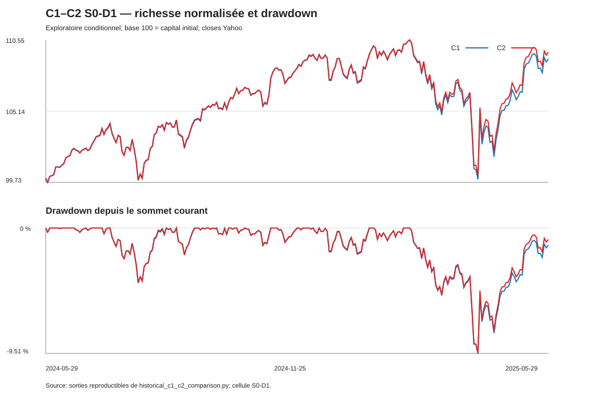

# Première comparaison historique C1–C2 — 2024–2025

Date d'exécution : 21 octobre 2026  
Contrat verrouillé : commit `8e9a0164d95ec19d2eace74f65506cdde6c891df`  
Mode : `EXPLORATORY_CONDITIONAL`  
Verdict : **`HISTORICAL_C1_C2_COMPARISON_VALIDATED`**

## 1. Question économique et résultat principal

Sur l'unique épisode préspécifié du 29 mai 2024 au 29 mai 2025, un portefeuille 50 % SPY / 50 % BIL rééquilibré chaque semaine selon le budget admissible E-B (C2) termine devant le même portefeuille conservé après l'achat initial (C1) dans les huit cellules autorisées.

L'avantage terminal de C2 varie de **519,07 USD à 590,12 USD**, soit **0,5191 à 0,5901 point de rendement**. C2 connaît également un drawdown maximal moins profond d'environ 0,184 à 0,197 point, mais sa volatilité annualisée est légèrement supérieure d'environ 0,066 à 0,067 point. Ce résultat descriptif ne démontre aucune supériorité générale du rééquilibrage.

## 2. Périmètre et hypothèses

- Capital initial : 100 000 USD par politique et cellule.
- Achat initial commun : 94 SPY et 544 BIL, figé au close du 28 mai puis exécuté à l'open du 29 mai 2024.
- C1 : aucune transaction après l'achat initial.
- C2 : 52 décisions à 08:00 `America/New_York`, cible 50/50 du budget E-B.
- Prix : closes et opens Yahoo, qualifiés de proxys exploratoires conditionnels.
- Règlement : T+1, calendrier DTC documenté, financement `H_FIN_NET`.
- Distributions : quatre SPY et douze BIL, sans réinvestissement automatique.
- Coûts : S0, S1, S2 et S3 à 0, 1, 5 et 10 pb.
- Cash : D+1 principal et D+2 en sensibilité.
- Terminal : close commune du 29 mai 2025, sans liquidation fictive.

Chaque cellule utilise ses propres registres C1 et C2. Aucun état n'est partagé entre cellules.

## 3. Validation des données utilisées

Le programme vérifie avant exécution les empreintes du manifeste, les 251 séances communes, les 52 lignes des deux grilles, les 52 opens/closes, les 52 règlements et les 16 distributions. Les grilles sont reconstruites en mémoire et comparées ligne à ligne aux CSV verrouillés.

| Élément | SHA-256 / résultat |
|---|---|
| empreinte commune des sources et du contrat | `01e698d5e2b1a88793d1a372addb9910a1ab20e26456f910a9594ef2aec641c9` |
| grille documentaire stricte | `d417dee20ba886d28dddcd2c42d2d8e9ebe8b77a30e5dfe00fd70adce1ed311c` |
| grille conditionnelle E-B | `d8f58b1bba900573d7b15cdf3af6d4d3648233d33746d6b3eb9e67758ea7af59` |
| séances communes | 251 / 251 |
| décisions E-B | 52 / 52 par cellule |
| distributions | 16 / 16 |
| règlements candidats | 52 / 52 `VERIFIED` |

Les résultats ne sont pas étiquetés point-in-time. Aucune nouvelle source de marché n'a été introduite.

## 4. Reproduction de C1

C1 retrouve exactement, au décimal près, les richesses terminales déjà publiées. D+1 et D+2 ne changent pas sa richesse : la convention affecte seulement l'admissibilité décisionnelle du cash, et C1 ne prend aucune décision après l'achat initial.

| Scénario | Référence publiée (USD) | Nouvelle exécution (USD) | Écart |
|---|---:|---:|---:|
| S0 | 109 025,95923914063984 | 109 025,95923914063984 | 0 |
| S1 | 109 016,02555939210468456 | 109 016,02555939210468456 | 0 |
| S2 | 108 976,2908403979640628 | 108 976,2908403979640628 | 0 |
| S3 | 108 926,6224416552882856 | 108 926,6224416552882856 | 0 |

Pour S0, les 94 SPY, 544 BIL, 3 007,818370 USD de distributions et le cash résiduel reproduisent exactement 109 025,959239 USD.

## 5. Résultats financiers par cellule

Les rendements et risques suivent les formules du contrat verrouillé. Les colonnes de volatilité et drawdown sont annualisées ou exprimées en pourcentage ; un drawdown moins négatif est meilleur.

| Cellule | C1 terminal USD | C2 terminal USD | Δ C2−C1 USD | Δ rendement, pt | Vol. C1 / C2 | MDD C1 / C2 | Frais C1 / C2 USD |
|---|---:|---:|---:|---:|---:|---:|---:|
| S0-D1 | 109 025,96 | 109 616,08 | +590,12 | +0,5901 | 10,0222 / 10,0882 % | −9,5138 / −9,3165 % | 0,00 / 0,00 |
| S1-D1 | 109 016,03 | 109 601,16 | +585,13 | +0,5851 | 10,0231 / 10,0894 % | −9,5147 / −9,3184 % | 9,93 / 14,72 |
| S2-D1 | 108 976,29 | 109 541,69 | +565,40 | +0,5654 | 10,0269 / 10,0925 % | −9,5181 / −9,3262 % | 49,67 / 73,83 |
| S3-D1 | 108 926,62 | 109 466,29 | +539,67 | +0,5397 | 10,0317 / 10,0988 % | −9,5224 / −9,3363 % | 99,34 / 147,67 |
| S0-D2 | 109 025,96 | 109 605,49 | +579,53 | +0,5795 | 10,0222 / 10,0884 % | −9,5138 / −9,3174 % | 0,00 / 0,00 |
| S1-D2 | 109 016,03 | 109 592,21 | +576,19 | +0,5762 | 10,0231 / 10,0891 % | −9,5147 / −9,3192 % | 9,93 / 14,88 |
| S2-D2 | 108 976,29 | 109 530,60 | +554,31 | +0,5543 | 10,0269 / 10,0927 % | −9,5181 / −9,3273 % | 49,67 / 74,29 |
| S3-D2 | 108 926,62 | 109 445,69 | +519,07 | +0,5191 | 10,0317 / 10,0992 % | −9,5224 / −9,3382 % | 99,34 / 149,39 |

Dans les huit cellules, C2 a le meilleur drawdown et C1 la plus faible volatilité. La durée maximale sous le sommet est de 69 séances pour les deux politiques. La pire séance varie d'environ −2,824 % à −2,829 % pour C2, contre −2,832 % à −2,835 % pour C1.

## 6. Différences de richesse et de rendement

L'avantage terminal de C2 diminue lorsque les coûts augmentent : sous D+1, il passe de 590,12 USD en S0 à 539,67 USD en S3 ; sous D+2, de 579,53 à 519,07 USD. Les frais expliquent une partie de cette réduction, mais les parts entières, les changements de positions et les distributions acquises empêchent d'assimiler chaque écart au seul montant des frais.

Les rendements totaux sont compris entre 8,9266 % et 9,0260 % pour C1, et entre 9,4457 % et 9,6161 % pour C2. L'annualisation utilise exactement `365,2425 / 365` conformément au contrat.

## 7. Risque et drawdowns

C2 réduit légèrement le drawdown maximal sur cet épisode, car les rééquilibrages limitent une partie de la dérive vers SPY pendant les phases de hausse et remettent ensuite du capital vers SPY après certaines baisses. Cette lecture est descriptive : aucune décomposition causale indépendante n'a été estimée.

La volatilité de C2 est néanmoins légèrement supérieure. Le rééquilibrage n'a donc pas amélioré simultanément toutes les dimensions de risque. Les différences sont petites relativement au risque total et ne doivent pas être extrapolées hors de cette fenêtre.

## 8. Transactions effectivement exécutées

| Cellule | Rééquilibrages exécutés | Holds | Lots rejetés | Achats / ventes exécutés | Notionnel de rééquilibrage USD |
|---|---:|---:|---:|---:|---:|
| S0-D1 | 47 | 5 | 0 | 41 / 35 | 48 052,97 |
| S1-D1 | 48 | 4 | 0 | 41 / 36 | 47 870,03 |
| S2-D1 | 49 | 3 | 0 | 42 / 35 | 48 332,12 |
| S3-D1 | 51 | 1 | 0 | 44 / 35 | 48 331,83 |
| S0-D2 | 48 | 4 | 0 | 41 / 36 | 48 409,56 |
| S1-D2 | 48 | 4 | 0 | 42 / 37 | 49 439,96 |
| S2-D2 | 49 | 3 | 0 | 42 / 35 | 49 238,26 |
| S3-D2 | 51 | 1 | 0 | 45 / 36 | 50 055,51 |

Les nombres d'achats et ventes excluent les deux achats initiaux communs. Un lot peut contenir simultanément un achat et une vente. Les coûts modifient légèrement le cash et les arrondis en parts entières ; ils peuvent donc changer si une décision devient un hold ou un petit ordre, sans qu'aucune règle ait été recalibrée.

## 9. Frais et financement

Les frais C2 totaux, achat initial inclus, sont respectivement 0 ; 14,72 ; 73,83 ; 147,67 USD sous D+1 et 0 ; 14,88 ; 74,29 ; 149,39 USD sous D+2. Les frais propres aux rééquilibrages sont 0 ; 4,79 ; 24,17 ; 48,33 USD sous D+1 et 0 ; 4,94 ; 24,62 ; 50,06 USD sous D+2.

Tous les lots exécutés satisfont `H_FIN_NET`. Aucun découvert, emprunt, short, redimensionnement ou vente de titres non réglés n'est observé. Les frais sont reconnus une fois et réconciliés avec le cash terminal.

## 10. Rejets et conséquences

Il n'y a **aucun lot rejeté** dans les huit cellules et donc aucun ordre rejeté. Les 416 décisions se répartissent uniquement entre `EXECUTED_HYPOTHETICAL` et `VOLUNTARY_HOLD`. Cette absence est un résultat de l'épisode et non une suppression des rejets : le journal conserve explicitement les colonnes de statut, motif et nombre d'ordres rejetés.

## 11. Distributions et disponibilité du cash

Les 16 événements sont comptabilisés pour chaque trajectoire. Les droits dépendent des positions réellement détenues à chaque ex-date. C1 acquiert et reçoit exactement 3 007,818370 USD. C2 acquiert entre 3 121,412347 et 3 123,879802 USD selon la cellule. Dans chaque exécution :

- somme des créances acquises = somme des paiements ;
- créances terminales = 0 ;
- le paiement transfère la créance au cash sans créer de richesse ;
- le montant inconnu reste absent des snapshots, hashes et intentions ;
- le détachement BIL du 3 juin n'est pas ajouté au close cum du 31 mai dans le budget.

Les différences de distributions C1–C2 reflètent les positions détenues aux ex-dates, pas un traitement comptable différent.

## 12. Sensibilité D+1 / D+2

C1 est invariant. Pour C2, retarder la disponibilité du cash à D+2 réduit la richesse terminale relativement à D+1 :

| Scénario | C2 D+2 moins D+1, USD | Différence de rendement |
|---|---:|---:|
| S0 | −10,59 | −0,0106 pt |
| S1 | −8,95 | −0,0089 pt |
| S2 | −11,09 | −0,0111 pt |
| S3 | −20,60 | −0,0206 pt |

L'effet est faible et non monotone avec les coûts en raison des parts entières et des ordres discrets. D+2 modifie certaines décisions, mais ne provoque ici aucun rejet.

## 13. Expositions et cash

En moyenne quotidienne, C1 porte environ 50,63–50,68 % de SPY et 47,16–47,20 % de BIL ; C2 environ 49,70–49,73 % de SPY et 49,83–49,84 % de BIL. Le reliquat correspond surtout au cash et, temporairement, aux créances ou règlements.

Au terminal :

- C1 détient 94 SPY et 544 BIL ; environ 50,87–50,92 % de la richesse est en SPY, 45,76–45,80 % en BIL et 3,28–3,37 % en cash.
- C2 détient 93 SPY et 591 ou 592 BIL ; environ 50,06–50,14 % est en SPY, 49,48–49,54 % en BIL et 0,34–0,43 % en cash.

L'écart moyen pré-décision à la cible E-B est compris entre 0,501 % et 0,529 %. Ces poids portent sur la richesse économique pour les expositions publiées ; la cible de décision reste définie sur le budget admissible.

## 14. Réconciliation comptable et reproductibilité

Les contrôles suivants passent :

- 4 016 lignes quotidiennes = 8 cellules × 2 politiques × 251 séances ;
- 416 lignes de décision = 8 cellules × 52 décisions ;
- identité quotidienne `positions + cash + créances + ventes à recevoir − achats à payer` avec écart nul ;
- 16 réconciliations terminales indépendantes avec écart nul ;
- achat initial C1 = achat initial C2 dans chaque cellule ;
- 16 distributions acquises et payées une fois ;
- quantités scellées inchangées après lecture des opens ;
- snapshots et intentions vérifiés par leurs SHA-256 ;
- reproduction byte-for-byte des cinq fichiers dérivés avec `--check`.

Empreintes des livrables :

| Fichier | SHA-256 |
|---|---|
| `trajectoires_quotidiennes.csv` | `6407a80efc20ea2a5defb73a95bcffc45d697ae7b8f8b762daceddd382085849` |
| `journal_decisions_c2.csv` | `41fa6239c2a67ed7725f411d50830a42c785d5543aed395350208668980fcd3f` |
| `synthese_financiere.csv` | `aa3b6b992a6b29f21fc4a3eef47127fb21f82ed47dc1412b29efb103fd8d53bf` |
| `comparaison_appariee.csv` | `e0b86234c6f5eb435c1dd6d426d22b3f0af265d2f8a231e3facecc45775ac311` |
| `trajectoire_et_drawdown_s0_d1.svg` | `7f3b936ae3f0ee23a97ac9cee4a1fa87963b04bb8927e66aa164dd4d540f4b10` |

## 15. Limites scientifiques

Cette comparaison porte sur un épisode unique et ne fournit ni distribution d'échantillonnage, ni test hors échantillon, ni preuve de robustesse à d'autres régimes. Yahoo Open et Close sont des proxys rétrospectifs, pas des archives point-in-time ou des fills. D+1/D+2 et `H_FIN_NET` stylisent un compte hypothétique. Les coûts ne modélisent ni spread variable, ni slippage, ni impact, ni fiscalité. Les annonces historiques complètes des distributions ne sont pas observées ; E-B exclut donc leurs montants inconnus du budget. Les parts entières créent des discontinuités et rendent certains effets de coûts non monotones.

Le rendement supérieur de C2 peut être décrit par sa trajectoire d'exposition différente, ses rééquilibrages, ses distributions et son cash plus faible. Les données ne permettent pas d'attribuer exactement les 519–590 USD à une cause unique.

## 16. Conclusion économique

Sur cet épisode précis, C2 a transformé davantage du capital disponible en exposition SPY/BIL, est resté plus proche de sa cible budgétaire et a terminé devant C1 dans toutes les cellules. Il a aussi connu un drawdown maximal légèrement meilleur, au prix d'une volatilité légèrement supérieure et de frais de rééquilibrage. D+2 dégrade modestement C2 par rapport à D+1 sans changer le sens de la comparaison.

La conclusion légitime est limitée : **dans cette réalisation historique conditionnelle, le rééquilibrage hebdomadaire E-B a produit une richesse terminale plus élevée et un drawdown légèrement moins profond que la conservation, mais pas une volatilité plus faible**.

La prochaine étape minimale, seulement après autorisation, serait de décider si ce résultat descriptif unique justifie une réplication préspécifiée sur un autre épisode réellement non consulté. Aucun changement de politique, calibrage ou RL n'est engagé ici.

